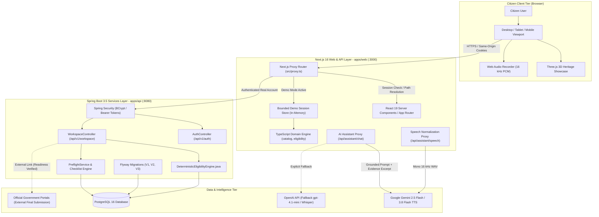
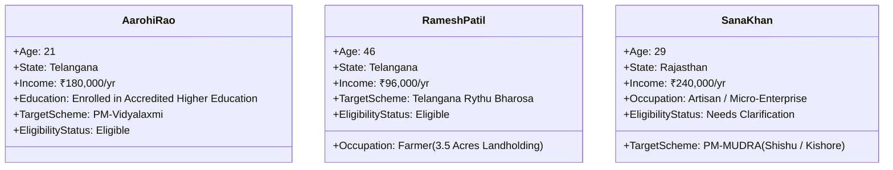

# ADHIKAAR AI

> *"Making Public Opportunities Accessible to Everyone."*

[](https://nextjs.org/)
[](https://react.dev/)
[](https://www.typescriptlang.org/)
[](https://tailwindcss.com/)
[](https://openjdk.org/)
[](https://spring.io/projects/spring-boot)
[](https://www.postgresql.org/)
[](https://ai.google.dev/)
[](https://threejs.org/)

**ADHIKAAR AI** is an AI-assisted civic discovery and application-preparation platform designed to help citizens discover government and NGO opportunities, understand eligibility requirements, prepare documents, and navigate application processes with clarity.

> [!IMPORTANT]
> **Independent Civic Guidance Notice**
> ADHIKAAR AI is an independent civic discovery and application-readiness platform. It is **not** an official government agency, portal, or public authority, and is not affiliated with, endorsed by, or sponsored by the Government of India or any State Government. All official submissions, fee payments, and formal determinations are conducted solely through verified official government portals.

---

## Table of Contents

- [1. Project Overview & Civic Problem](#1-project-overview--civic-problem)
- [2. Key Features & Implementation Matrix](#2-key-features--implementation-matrix)
- [3. Technology Stack](#3-technology-stack)
- [4. System Architecture](#4-system-architecture)
- [5. Citizen Application Workflow](#5-citizen-application-workflow)
- [6. Visual Design & Heritage 3D Showcase](#6-visual-design--heritage-3d-showcase)
- [7. Synthetic Personas & Demo Mode](#7-synthetic-personas--demo-mode)
- [8. AI Civic Guidance & Speech Processing](#8-ai-civic-guidance--speech-processing)
- [9. Getting Started & Installation](#9-getting-started--installation)
- [10. Environment Variables](#10-environment-variables)
- [11. Verification & Automated Test Suites](#11-verification--automated-test-suites)
- [12. Security, Privacy & Data Protection](#12-security-privacy--data-protection)
- [13. Repository Structure](#13-repository-structure)
- [14. Project Roadmap](#14-project-roadmap)
- [15. Contributing & Code Standards](#15-contributing--code-standards)
- [16. License](#16-license)
- [17. Acknowledgements](#17-acknowledgements)
- [18. Disclaimer](#18-disclaimer)

---

## 1. Project Overview & Civic Problem

Every fiscal year, public administrations and charitable foundations establish welfare schemes, educational subsidies, agricultural credits, and MSME capital grants. Despite these initiatives, millions of eligible citizens face systemic barriers to entry:

1. **Information Asymmetry & Fragmentation**: Opportunities are dispersed across central portals, state gazettes, and district-level notices, making discovery unpredictable and time-consuming.
2. **Ambiguous Eligibility Criteria**: Eligibility clauses often involve complex legal and bureaucratic phrasing (e.g., annual parental income ceilings, land ceiling certificates, caste validity, margin money formulas), leading citizens to self-disqualify prematurely or apply in error.
3. **The Documentation Deficit**: More than 60% of incomplete applications fail due to missing ancillary paperwork (e.g., non-creamy layer affidavits, provisional college allotment letters, land title RoR 1-B records).
4. **Fear of Hallucinated Promises**: Traditional generative AI assistants risk fabricating deadlines, inventing quotas, or falsely guaranteeing approvals to vulnerable users.

### The ADHIKAAR AI Approach

ADHIKAAR AI resolves these bottlenecks through an **explainable, dual-tier engineering approach**:
- **Deterministic Rules Engine**: High-stakes eligibility calculations and mandatory documentation checks run on pure, deterministic boolean logic. LLMs are never permitted to guess or overwrite eligibility conclusions.
- **Grounded AI Civic Assistance**: AI model outputs are strictly constrained by official scheme gazette extracts. Every conversational answer requires an exact supporting citation excerpt from the server-managed scheme catalogue.
- **Application Preflight & Readiness**: Instead of generic checklists, ADHIKAAR AI generates structured, status-aware document readiness workflows that map user progress across each individual requirement before they ever visit an official government portal.

---

## 2. Key Features & Implementation Matrix

ADHIKAAR AI maintains strict boundaries between completed, experimental, and planned capabilities. The table below represents the audited technical status of each feature:

| Domain | Capability / Module | Status | Technical Details |
| :--- | :--- | :--- | :--- |
| **Discovery** | Curated Scheme Catalogue | **Implemented** | Curated programmes (PM-Vidyalaxmi, TS Rythu Bharosa, PM-MUDRA) with verified official URLs, issuing authorities, and benefit amounts. |
| **Discovery** | Multi-attribute Programme Search | **Implemented** | Real-time filtering by category (Education, Agriculture, Business), state jurisdiction, and beneficiary profile. |
| **Eligibility** | Deterministic Rules Engine | **Implemented** | Pure rule evaluation (`DeterministicEligibilityEngine.java` / `src/lib/domain/eligibility.ts`). Distinguishes missing profile inputs from unmet criteria; never infers approval. |
| **Eligibility** | Explainable Criteria Breakdown | **Implemented** | Evaluates criteria on exact user metrics (income, age, landholding, enrollment) and renders pass/fail/missing status for each condition. |
| **Preflight** | Application Preflight Engine | **Implemented** | Structured document audit tracking `NOT_STARTED`, `IN_PROGRESS`, `READY`, and `BLOCKED` states per scheme. |
| **Preflight** | Requirement Guidance & Notes | **Implemented** | Step-by-step guidance on issuing authorities, acceptable formats, and common delay factors. |
| **Workspace** | Personal Preparation Journeys | **Implemented** | Stateful milestone tracking per scheme, from initial discovery to portal submission readiness. |
| **Workspace** | Saved Schemes & Bookmarking | **Implemented** | Citizen workspace persistence for scheme shortlisting, comparison, and review. |
| **Workspace** | Citizen Dashboard | **Implemented** | Aggregated overview displaying active journeys, document readiness ratios, notifications, and recommended schemes. |
| **Auth & State** | Account Authentication | **Implemented** | Spring Security + BCrypt with expiring bearer session tokens stored in secure, SameSite HttpOnly cookies. |
| **Auth & State** | Zero-Dependency Demo Mode | **Implemented** | Instant access via synthetic citizen personas (Aarohi Rao, Ramesh Patil, Sana Khan). Session isolation in bounded memory. |
| **AI Guidance** | Grounded Civic Assistant | **Implemented** | Google Gemini (`gemini-2.5-flash`) with mandatory evidence excerpt extraction. Optional OpenAI fallback (`gpt-4.1-mini`). |
| **Multilingual** | Multilingual Interface | **Implemented** | UI localizations covering English (`en`), Hindi (`hi`), Telugu (`te`), Marathi (`mr`), Tamil (`ta`), and Kannada (`kn`). |
| **Voice / Speech** | Speech-to-Text (STT) | **Experimental** | Audio capture via Web Audio API, resampled client-side to mono 16 kHz PCM WAV, transcribed via Gemini Interactions API / Whisper. |
| **Voice / Speech** | Text-to-Speech (TTS) | **Experimental** | Synthesizes response audio via `gemini-3.8-flash-tts` for accessibility. |
| **Notifications**| System Notifications | **Implemented** | Time-stamped alerts for document readiness changes, journey milestones, and system notices. |
| **Profile** | Profile & Document Settings | **Implemented** | Profile attributes (age, state, category, income, landholding) feeding directly into the eligibility engine. |
| **Experience** | Interactive 3D Architectural Model | **Implemented** | Real-time Three.js / React Three Fiber interactive Indian archway showcase with orbit controls. |
| **Integration** | Direct Govt Portal Submission | **Planned / Non-Goal** | Final submission is deliberately deferred to official government portals to preserve privacy and statutory compliance. |

---

## 3. Technology Stack

### Frontend Architecture
- **Framework**: [Next.js](https://nextjs.org/) `16.4.6` (App Router, Turbopack, React Server Components, Next.js 16 Proxy routing)
- **Core Library**: [React](https://react.dev/) `19.3.0` & [React DOM](https://react.dev/) `19.3.0`
- **Language**: [TypeScript](https://www.typescriptlang.org/) `5.8.2` (Strict type checking, zero `any` policy for domain rules)
- **Styling**: [Tailwind CSS](https://tailwindcss.com/) `4.3.3` (Engineered CSS design system: Sapphire `#172943`, Ivory `#F7F2E9`, Antique Gold `#BC9059`)
- **Iconography**: [Lucide React](https://lucide.dev/) `1.77.0`
- **Animations**: [Motion](https://motion.dev/) `14.14.0`
- **3D Graphics**: [Three.js](https://threejs.org/) `0.187.0`, [@react-three/fiber](https://r3f.docs.pmnd.rs/) `9.8.2`

### Backend Architecture
- **Runtime**: [Java](https://openjdk.org/) `21` (LTS)
- **Framework**: [Spring Boot](https://spring.io/projects/spring-boot) `3.5.0`
- **Security**: Spring Security 6 with BCrypt password hashing and stateless token validation
- **Persistence**: Spring Data JPA / Hibernate 6 with PostgreSQL dialect
- **Database Migrations**: [Flyway](https://flywaydb.org/) `10.x` (`V1__init_schema.sql`, `V2__citizen_workspace.sql`, `V3__remove_unverified_defaults.sql`)
- **API Documentation**: [Springdoc OpenAPI](https://springdoc.org/) `2.8.9` (Swagger UI at `/swagger-ui.html`)
- **Monitoring**: Spring Boot Actuator health and readiness probes

### Database & Infrastructure
- **Production Database**: [PostgreSQL](https://www.postgresql.org/) `16` (Alpine Linux container)
- **Test Database**: [H2 Database](https://www.h2database.com/) `2.3.232` (In-memory, isolated schema for integration testing)
- **Containerization**: Docker Compose (`docker-compose.yml`)

### AI & Speech Infrastructure
- **Primary AI Provider**: [Google Gemini API](https://ai.google.dev/) (`@google/genai` `1.4.0`)
  - **Reasoning / Grounding**: `gemini-2.5-flash`
  - **Voice Synthesis (TTS)**: `gemini-3.8-flash-tts`
- **Fallback AI Provider**: [OpenAI API](https://platform.openai.com/) (`openai` `4.86.1`)
  - **Chat Engine**: `gpt-4.1-mini`
  - **Transcription (STT)**: `whisper-1` (verbose JSON with log probability validation)
- **Audio Client**: Browser Web Audio API with custom mono 16 kHz PCM WAV normalization

---

## 4. System Architecture

ADHIKAAR AI operates in two complementary deployment modes:
1. **Standalone Demo Mode**: Fully functional Next.js instance utilizing client-side domain rules and an in-memory session store. Does not require Java, PostgreSQL, or live AI credentials.
2. **Full-Stack Enterprise Mode**: Production-grade microservices topology pairing the Next.js edge tier with the Spring Boot rules engine and PostgreSQL.

### Architecture Diagram



---

## 5. Citizen Application Workflow

ADHIKAAR AI guides citizens through an eight-step application readiness lifecycle:

```mermaid
flowchart LR
    Step1["1. Enter Portal\n(Demo or Real Account)"] --> Step2["2. Explore Catalogue\n(Search, Filter & Compare)"]
    Step2 --> Step3["3. Review Details\n(Benefits, Criteria, Source)"]
    Step3 --> Step4["4. Check Eligibility\n(Deterministic Rules Engine)"]
    Step4 --> Step5["5. Preflight Checklist\n(Document Audit & Readiness)"]
    Step5 --> Step6["6. Consult Assistant\n(Grounded Scheme Guidance)"]
    Step6 --> Step7["7. Track Journey\n(Stateful Milestones)"]
    Step7 --> Step8["8. Official Submission\n(External Govt Portal)"]
```



1. **Enter Portal**: The citizen authenticates via standard sign-up or enters zero-dependency demo mode with a pre-configured synthetic profile.
2. **Explore Catalogue**: The user browses official schemes across Education, Agriculture, and MSME sectors with verified authority metadata.
3. **Review Details**: The citizen views full programme terms, financial benefit ceilings, mandatory rules, and official gazette citations.
4. **Check Eligibility**: The deterministic rules engine cross-examines the citizen's profile attributes against statutory conditions, explaining which criteria are met, which failed, and what data is missing.
5. **Application Preflight**: The user works through a tailored document checklist, tracking the readiness of affidavits, income proofs, and land records.
6. **Consult Civic Assistant**: The citizen asks questions in their preferred language. The assistant responds exclusively using grounded source material from official notices.
7. **Track Application Journey**: Preparation milestones are recorded in the personal citizen workspace, providing visibility into overall readiness.
8. **Official Submission**: With documents verified and criteria satisfied, the platform provides direct links to the relevant state or central portal for formal filing.

---

## 6. Visual Design & Heritage 3D Showcase

ADHIKAAR AI features an intentional, civic visual identity built around classical Indian architecture and modern accessibility standards:

- **Palette**: Deep Sapphire (`#172943`), Warm Ivory (`#F7F2E9`), Antique Gold (`#BC9059`), and Terracotta accents.
- **Typography**: Editorial serif headers powered by **Fraunces**, paired with clean, accessible sans-serif body text powered by **Manrope**.
- **Hero Photograph**: The landing page preserves the approved high-resolution architectural archway photograph (`public/images/landing-archway-hq.jpg`), optimized for high-DPI and Retina displays with zero aspect ratio distortion or layout shifts.
- **3D Heritage Showcase**: An interactive Three.js / React Three Fiber canvas renders a procedural stone-carved heritage archway on the landing page, symbolizing strength, civic dignity, and transparency.
- **Responsive Geometry**: Fully adaptive grid and flex layouts supporting mobile (375px+), tablet (768px+), and wide desktop displays (1920px+).

---

## 7. Synthetic Personas & Demo Mode

To allow complete, frictionless evaluation without entering real personal data or connecting to external databases, ADHIKAAR AI provides three realistic, synthetic citizen personas:



### Demo Mode Security & Isolation Guarantees
- **Zero Real PII**: No real citizen records are stored, manipulated, or required during demo sessions.
- **Process-Local Memory Storage**: Demo workspaces are isolated in a bounded server memory store (`src/lib/server/demo-session-store.ts`).
- **No Cross-Persona Leakage**: Switching personas immediately remounts the workspace with clean, persona-specific data fixtures.
- **Independent Reset**: Citizens can reset synthetic progress at any time, restoring baseline demo values without affecting other active sessions.

---

## 8. AI Civic Guidance & Speech Processing

ADHIKAAR AI incorporates a grounded AI guidance architecture designed to eliminate hallucinations and prevent false assurances.

```mermaid
sequenceDiagram
    autonumber
    actor Citizen
    participant Client as Web Client (Next.js)
    participant Server as Assistant Controller
    participant Rules as Deterministic Rules Engine
    participant Gemini as Google Gemini 2.5 Flash

    Citizen->>Client: Asks: "Do I qualify for PM-Vidyalaxmi?"
    Client->>Server: POST /api/assistant/chat (Question, SchemeID, Session Cookie)
    Note over Server: Server strips all PII (Name, Email, Identifiers)
    Server->>Rules: Compute Deterministic Eligibility
    Rules-->>Server: Result: { status: "ELIGIBLE", criteriaChecked: [...] }
    Server->>Server: Retrieve Official Gazette HTML Extract
    Server->>Gemini: Prompt with Strict Grounding Guardrails + Gazette Text + Rule Result
    Note over Gemini: Must cite exact evidence quote;<br/>Cannot override rule status;<br/>Cannot promise approval
    Gemini-->>Server: Structured JSON Response { answer, evidenceExcerpt, citations }
    Server-->>Client: Verified, Grounded Guidance
    Client-->>Citizen: Renders Answer with Gazette Quote and Verification Badge
```

### Safety & Grounding Guardrails
1. **PII Sanitization**: User identity attributes (names, emails, phone numbers, exact addresses) are stripped before prompts are constructed.
2. **Strict Evidence Extraction**: The assistant must provide an exact string quotation from the official scheme text. If the official document does not mention the topic, the model is instructed to express uncertainty.
3. **Immutable Rule Authority**: The AI model cannot modify, override, or invent eligibility determinations. The server binds the deterministic engine's output to the response payload.
4. **Token Streaming Restriction**: AI responses are buffered and fully validated against safety schemas before being presented to the user.

### Experimental Speech Pipeline
- **Audio Capture**: Captures microphone input via standard browser `MediaRecorder` (supporting WebM/Opus and MP4/AAC).
- **Client-Side Normalization**: The browser Web Audio API decodes the clip and resamples the audio stream to clean, uncompressed **mono 16 kHz PCM WAV**.
- **Signal Quality Gate**: Clips with low signal amplitude, DC bias, or durations under 0.5s are rejected early with user guidance.
- **Speech-to-Text**: Forwarded to Google Gemini's audio processing interface or OpenAI Whisper with language hints for English (`en`), Hindi (`hi`), and Telugu (`te`).

---

## 9. Getting Started & Installation

### Prerequisites
- **Node.js**: `v20.x` or `v22.x` (LTS recommended)
- **npm**: `v10.x` or higher
- **Java**: `Java 21` (Only required for Full-Stack Spring Boot mode)
- **Maven**: `3.9+` (Wrapper `./backend/mvnw` provided)
- **Docker**: Docker Desktop or Docker Engine with Docker Compose (Only required for PostgreSQL container)

---

### Mode A: Standalone Demo Mode (Quickest)

Run the full web experience without installing Java, PostgreSQL, or setting up external API keys.

```bash
# 1. Clone the repository
git clone https://github.com/codebenders/adhikaar.git
cd adhikaar

# 2. Install Node dependencies
npm install

# 3. Configure environment file
cp .env.example .env.local

# 4. Start Next.js development server
npm run dev
```

Open `http://localhost:3000` in your browser. Click **"Sign In"** and choose **"Sign in with Demo"** to access the synthetic citizen workspace.

---

### Mode B: Full-Stack Enterprise Mode

Run the complete architecture with the Spring Boot backend, Flyway migrations, and PostgreSQL.

```bash
# 1. Start PostgreSQL 16 container
docker compose up -d postgres

# 2. Run Flyway migrations & start Spring Boot backend
export DB_PASSWORD=adhikaar_secure_password
npm run dev:backend
# Or directly: ./apps/api/mvnw -f apps/api/pom.xml spring-boot:run

# 3. In a separate terminal, start Next.js frontend
npm run dev
```

- **Frontend Application**: `http://localhost:3000`
- **Spring Boot Backend**: `http://localhost:8080`
- **Swagger / OpenAPI Documentation**: `http://localhost:8080/swagger-ui.html`
- **Actuator Health Check**: `http://localhost:8080/actuator/health`

---

### Local Production Preview

To test an optimized production build locally:

```bash
# Build production bundle
npm run build

# Start production server with HTTP cookie compatibility
COOKIE_SECURE=false npm run start -- --hostname localhost --port 3100
```

Access the preview at `http://localhost:3100`.

---

## 10. Environment Variables

Store all sensitive environment configurations in `.env.local` (which is excluded from Git via `.gitignore`). **Never prefix secrets with `NEXT_PUBLIC_`.**

| Variable | Scope | Required | Default Value | Description |
| :--- | :--- | :--- | :--- | :--- |
| `BACKEND_URL` | Server | Yes (Full-Stack) | `http://localhost:8080` | Upstream Spring Boot REST API address (server-to-server only). |
| `AI_PROVIDER` | Server | Optional | `gemini` | Configured AI provider: `gemini` (recommended) or `openai`. |
| `GEMINI_API_KEY` | Server | Optional | *None* | Google Gemini API key for live grounding and speech features. |
| `GEMINI_MODEL` | Server | Optional | `gemini-2.5-flash` | Gemini model identifier used for conversational civic reasoning. |
| `GEMINI_TTS_MODEL` | Server | Optional | `gemini-3.8-flash-tts` | Gemini model identifier used for text-to-speech audio rendering. |
| `OPENAI_API_KEY` | Server | Optional | *None* | OpenAI API key for legacy/fallback support. |
| `OPENAI_CHAT_MODEL` | Server | Optional | `gpt-4.1-mini` | OpenAI chat model for legacy fallback. |
| `OPENAI_TRANSCRIPTION_MODEL` | Server | Optional | `whisper-1` | OpenAI model identifier for speech transcription fallback. |
| `COOKIE_SECURE` | Server | Optional | `true` | Set to `false` *only* for local HTTP preview servers (`localhost:3100`). |
| `DB_URL` | Backend | Yes (Backend) | `jdbc:postgresql://localhost:5432/adhikaar` | JDBC connection URL for PostgreSQL. |
| `DB_USERNAME` | Backend | Yes (Backend) | `adhikaar` | Database user name. |
| `DB_PASSWORD` | Backend | Yes (Backend) | *None* | Database password (configured via shell/Docker). |
| `SPEECH_DEBUG` | Server | Dev Only | `false` | Enables verbose server-side provider logging during audio testing. |
| `NEXT_PUBLIC_SPEECH_DEBUG` | Browser | Dev Only | `false` | Exposes client-side audio playback controls for developer inspection. |

---

## 11. Verification & Automated Test Suites

The codebase includes end-to-end verification suites spanning TypeScript type integrity, domain rules, API endpoints, and authenticated routing:

```bash
# 1. Typecheck the entire Next.js codebase (Zero TypeScript errors)
npm run typecheck

# 2. Run ESLint checks
npm run lint

# 3. Execute domain rules and unit tests (67 passing tests)
npm test

# 4. Run API route integration tests (10 passing, 1 skipped)
npm run test:api

# 5. Run authentication proxy & navigation tests (9 passing tests)
npm run test:nav

# 6. Execute Spring Boot backend unit and integration tests
npm run test:backend
# Or directly: ./apps/api/mvnw -f apps/api/pom.xml test

# 7. Compile and verify complete Next.js production build (37 static pages)
npm run build
```

### Verified Test Summary

| Test Suite | File / Script | Passing | Skipped | Core Coverage |
| :--- | :--- | :---: | :---: | :--- |
| **Domain Logic** | `scripts/test-domain.mjs` | **67** | 0 | Deterministic eligibility, demo fixtures, audio resampling, CSRF tokens |
| **API Endpoints** | `tests/api.test.mjs` | **10** | 1 | Auth sessions, session isolation, CSRF origin checks, rate limiting |
| **Navigation & Auth** | `tests/navigation.test.mjs` | **9** | 0 | Next.js 16 proxy routing, sidebar navigation links, persona switching |
| **Type Integrity** | `tsc --noEmit` | **0 errors**| — | Strict TypeScript compliance across all components and libraries |
| **Static Build** | `next build` | **37 pages** | — | Clean Turbopack compilation across all routes with zero static export errors |

---

## 12. Security, Privacy & Data Protection

ADHIKAAR AI adheres to strict civic data protection principles:

1. **Stateless Bearer Tokens**: Authenticated sessions are managed via cryptographically signed tokens delivered over `HttpOnly`, `SameSite=Lax`, `Secure` cookies.
2. **Zero PII Exposure to LLMs**: Personal identifying records are never transmitted to third-party AI APIs. Only anonymous scheme requirements and deterministic eligibility codes are evaluated.
3. **CSRF & Origin Verification**: All state-modifying requests (`POST`, `PUT`, `DELETE`) enforce same-origin verification and custom header gates.
4. **Input Sanitization**: Conversational inputs and uploaded parameters undergo strict validation and schema conformity checks before processing.
5. **No Long-Term Audio Retention**: Audio clips captured for speech-to-text processing are held in volatile server memory solely for the duration of the transcription request, after which they are destroyed immediately.

---

## 13. Repository Structure

```text
codebenders/
├── .editorconfig                    # Consistent cross-editor coding standards
├── .env.example                     # Root reference environment template
├── .gitignore                       # Monorepo-aware Git exclusion rules
├── docker-compose.yml               # Multi-container orchestration (PostgreSQL + API)
├── package.json                     # Monorepo workspace root (npm workspaces)
├── README.md                        # Master repository documentation
│
├── .github/                         # GitHub repository configuration
│   ├── ISSUE_TEMPLATE/              # Structured bug reports & feature requests
│   └── workflows/                   # Automated CI pipelines (Web & Java tests)
│
├── apps/
│   ├── web/                         # Next.js 16 Web Application Tier
│   │   ├── .env.example             # Web application environment template
│   │   ├── eslint.config.mjs        # Next.js ESLint configuration
│   │   ├── next.config.ts           # Next.js 16 configuration & instant insight gates
│   │   ├── package.json             # Web dependencies (@adhikaar/web)
│   │   ├── tsconfig.json            # TypeScript configuration (paths: @/* -> ./src/*)
│   │   ├── public/                  # Static assets & high-resolution imagery
│   │   │   └── images/              # Preserved architectural photographs (landing-archway-hq.jpg)
│   │   ├── scripts/                 # Web test runners & QA automation scripts
│   │   ├── tests/                   # API, navigation, speech, and origin test suites
│   │   └── src/
│   │       ├── proxy.ts             # Next.js 16 proxy routing gate
│   │       ├── app/                 # Next.js 16 App Router (routes, layouts, API endpoints)
│   │       │   ├── (auth)/          # Sign-in, sign-up & password recovery
│   │       │   ├── (public)/        # Public landing, about, terms & privacy
│   │       │   ├── api/             # Server API routes (assistant, speech, auth, demo)
│   │       │   └── app/             # Authenticated Citizen Workspace
│   │       │       ├── assistant/   # AI Civic Guide conversational view
│   │       │       ├── discover/    # Scheme discovery & filtering
│   │       │       ├── eligibility/ # Interactive eligibility audit
│   │       │       ├── help/        # Help, trust & FAQ
│   │       │       ├── journey/     # Application journey tracking
│   │       │       ├── notifications/ # User notifications center
│   │       │       ├── preflight/   # Preflight document readiness
│   │       │       ├── profile/     # Citizen profile management
│   │       │       ├── saved/       # Bookmarked schemes
│   │       │       ├── schemes/[id] # Scheme detail views
│   │       │       └── settings/    # Workspace settings
│   │       ├── components/          # Reusable component library
│   │       │   ├── assistant/       # Conversational dialog & voice review
│   │       │   ├── auth/            # Authentication shells & split layouts
│   │       │   ├── demo/            # Demo banner & persona switcher
│   │       │   ├── home/            # Landing page sections & preflight cards
│   │       │   ├── layout/          # Navigation bars, topbar & sidebar
│   │       │   ├── three/           # Three.js 3D heritage model & canvas
│   │       │   ├── ui/              # Primitive design system (button, card, badge)
│   │       │   └── workspace/       # Workspace state gates
│   │       ├── features/            # Feature-sliced modules
│   │       │   ├── assistant/       # Assistant & voice pipeline features
│   │       │   ├── authentication/  # Auth features & hooks
│   │       │   ├── dashboard/       # Dashboard widgets & state
│   │       │   ├── discovery/       # Scheme search & catalogue
│   │       │   ├── eligibility/     # Deterministic evaluation rules
│   │       │   ├── journeys/        # Milestone & progress tracking
│   │       │   ├── notifications/   # System alerts & updates
│   │       │   ├── preflight/       # Document audit checklists
│   │       │   ├── profile/         # User profile & synthetic personas
│   │       │   └── settings/        # Preferences & configuration
│   │       └── lib/                 # Core domain logic & server utilities
│   │           ├── domain/          # Catalog, eligibility, demo fixtures, speech audio
│   │           └── server/          # AI providers, demo session store, transcription
│   │
│   └── api/                         # Java Spring Boot 3.5 Backend Tier
│       ├── .env.example             # Backend environment template
│       ├── .gitignore               # Maven & Java exclusion rules
│       ├── Dockerfile               # Production container definition
│       ├── mvnw / mvnw.cmd          # Maven wrapper executables
│       ├── pom.xml                  # Maven POM (Spring Boot 3.5, Java 21)
│       └── src/
│           ├── main/
│           │   ├── java/com/adhikaarai/backend/
│           │   │   ├── AdhikaarBackendApplication.java
│           │   │   ├── assistant/   # AI Assistant Spring integration service
│           │   │   ├── config/      # Spring Security & WebMvc configuration
│           │   │   ├── controller/  # REST API Controllers (Auth, Workspace, Schemes)
│           │   │   ├── dto/         # Request & response data transfer objects
│           │   │   ├── entity/      # JPA Hibernate entities
│           │   │   ├── repository/  # Spring Data JPA repositories
│           │   │   ├── rules/       # Java DeterministicEligibilityEngine.java
│           │   │   └── service/     # Core application services
│           │   └── resources/
│           │       ├── application.yml # Spring properties & Actuator probes
│           │       └── db/migration/   # Flyway migrations (V1, V2, V3)
│           └── test/                # Spring Boot JUnit 5 test suites
│
├── packages/
│   └── shared/                      # Shared contracts, types & schemas
│       └── README.md                # Shared contract documentation
│
├── infra/
│   ├── database/                    # Database documentation & migration guides
│   └── docker/                      # Multi-service Docker Compose definitions
│
├── docs/                            # Categorized architectural & audit documentation
│   ├── architecture/                # System architecture & 3D heritage model
│   ├── api/                         # REST API specifications & endpoints
│   ├── development/                 # Dev guide, demo mode & speech pipeline
│   ├── deployment/                  # Docker & production deployment
│   └── testing/                     # QA test plans & audit verification logs
│
└── scripts/                         # Monorepo convenience shell scripts
    ├── build.sh                     # Monorepo full build runner
    ├── dev.sh                       # Local development launcher
    └── test.sh                      # Complete automated test runner
```

---

## 14. Project Roadmap

- [x] **Phase 1: Core Foundation (v0.1.0)**
  - Deterministic eligibility rules engine for central and state schemes.
  - Interactive Application Preflight document readiness auditor.
  - High-resolution architectural interface with Three.js heritage showcase.
  - Zero-dependency demo mode with three synthetic citizen personas.
- [ ] **Phase 2: Expanded Programme Catalogue**
  - Add 25+ high-impact schemes across health (Ayushman Bharat), agriculture (PM-KISAN), and housing (PMAY).
  - Implement automated gazette scrapers with human-in-the-loop verification.
- [ ] **Phase 3: Deep Multilingual Expansion**
  - Full voice synthesis and transcription across 12 official Indian languages.
  - Dialect-aware localized civic phrase recognition.
- [ ] **Phase 4: Offline PWA & Digital Locker Exploration**
  - Offline-first Service Worker caching for rural and low-bandwidth environments.
  - Feasibility study for voluntary, read-only DigiLocker document verification integration.

---

## 15. Contributing & Code Standards

We welcome community contributions, bug fixes, and documentation improvements.

### Development Guidelines
1. **Branch Naming**: Use descriptive prefixes: `feature/`, `bugfix/`, `docs/`, or `refactor/`.
2. **Commit Conventions**: Follow [Conventional Commits](https://www.conventionalcommits.org/):
   - `feat: add land ceiling validation rule for Rythu Bharosa`
   - `fix: resolve mobile navigation backdrop blur issue`
   - `docs: update environment variable instructions`
3. **Strict TypeScript Standards**: All new frontend code must compile cleanly under `npm run typecheck`. Do not use `any` types for domain models.
4. **Testing Required**: Any modification to eligibility rules, preflight checks, or session management must include corresponding unit tests in `scripts/test-domain.mjs` or `tests/`.

---

## 16. License

This repository and its codebase are currently **Unlicensed / Proprietary**. All rights are reserved.

No open-source license (such as MIT or Apache 2.0) has been formally applied to this repository yet. If you are interested in using, adapting, or deploying ADHIKAAR AI for academic, non-profit, or governmental research, please contact the maintainers directly.

---

## 17. Acknowledgements

ADHIKAAR AI is built upon the contributions of the open-source software community and public civic resources:
- **Frameworks & Engines**: [Next.js](https://nextjs.org/) by Vercel, [React](https://react.dev/) by Meta, [Spring Boot](https://spring.io/) by VMware/Broadcom, [Three.js](https://threejs.org/) by Ricardo Cabello and contributors.
- **AI Infrastructure**: [Google Gemini](https://ai.google.dev/) by Google DeepMind.
- **Public Data Sources**: Official notifications and gazettes from the Government of India, the Ministry of Education, the Ministry of MSME, and the Government of Telangana.

---

## 18. Disclaimer

ADHIKAAR AI is an independent civic exploration and application readiness tool. It is **NOT** affiliated with, authorized by, sponsored by, or an official agency of the Government of India or any State Government.

All scheme names, logos, official portal links, and programme titles are trademarks or registered marks of their respective public authorities. ADHIKAAR AI does not collect application fees, submit formal applications on behalf of citizens, or guarantee approval for any public opportunity. All formal applications must be submitted directly through official government portals.
