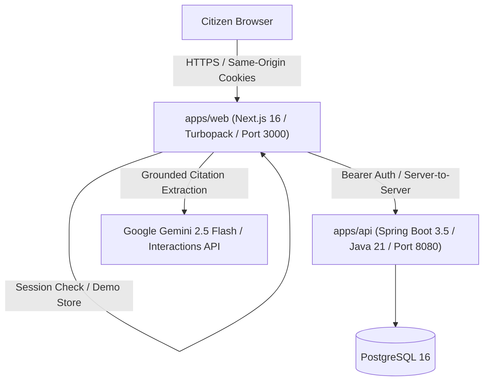

# System Architecture & Topology

ADHIKAAR AI is structured as a high-reliability, dual-engine civic intelligence platform.

## High-Level Topology

## Architectural Boundaries

1. **Edge Tier (`apps/web`)**:
   - Next.js 16 App Router with React 19 Server Components.
   - Proxy routing gate (`src/proxy.ts`) for redirect protection and authentication boundaries.
   - Bounded in-memory demo session store (`src/lib/server/demo-session-store.ts`) for instant evaluation with synthetic personas.
   - Web Audio client normalizing microphone input to mono 16 kHz PCM WAV.
2. **Services Tier (`apps/api`)**:
   - Spring Boot 3.5 application with Spring Security 6.
   - Pure deterministic eligibility rules engine (`DeterministicEligibilityEngine.java`).
   - Flyway automated schema migrations.
3. **Data Tier**:
   - PostgreSQL 16 containerized via Docker.
   - Zero real PII sent to third-party AI APIs.
